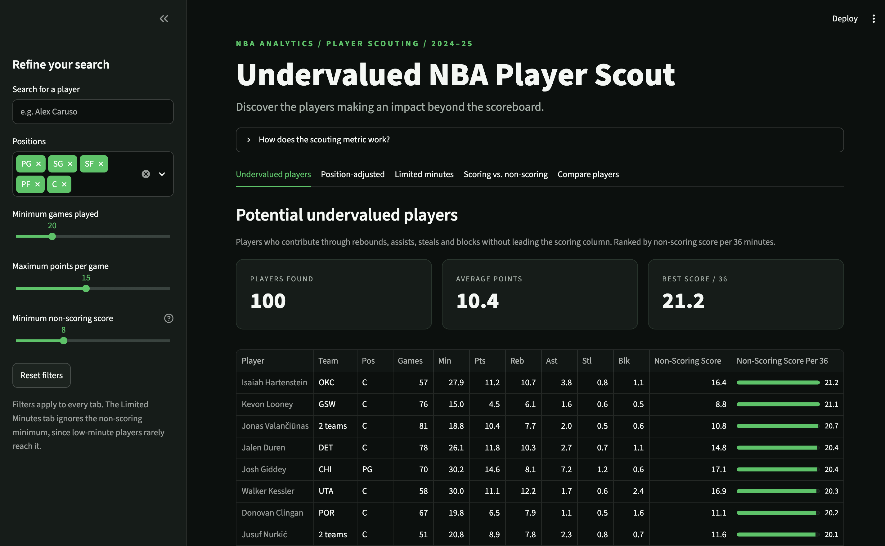

# 🏀 Undervalued NBA Player Scout
[🚀 Live Dashboard](https://nba-undervalued-scout-eyeftjvfwkbot4vqb8q4yf.streamlit.app/)
An interactive Streamlit dashboard that surfaces NBA players who help their teams through **rebounds, assists, steals and blocks** rather than points. Built on 2024–25 per-game data from Basketball-Reference.

<!-- Add a screenshot: docs/screenshot.png -->


## Features

- **Undervalued players**: a filterable leaderboard ranked by non-scoring production per 36 minutes
- **Position-adjusted ranking**: compares each player with the average at their own position
- **Limited minutes**: finds bench players who make the most of a small role
- **Scoring vs. non-scoring chart**: interactive scatter with hover details
- **Player comparison**: side-by-side table and chart for any two players
- CSV export of the filtered results

## The metric

| Metric | Definition |
|---|---|
| Non-Scoring Score | rebounds + assists + steals + blocks per game |
| Non-Scoring Score Per 36 | Non-Scoring Score ÷ minutes per game × 36 |
| Position-Adjusted Score | per-36 score ÷ average per-36 score at the player's listed position |

Positional averages are computed only from players with at least 10 games and 10 minutes per game, so a few garbage-time appearances don't distort the baseline.

This is an exploratory metric, not an official measure of player value. It ignores shooting efficiency, turnovers, defense beyond steals and blocks, and teammate quality.

## Data notes

The raw Basketball-Reference export needs cleaning before analysis (`nba_scout/data.py`):

- a citation blurb sits above the header and a footer below the data
- a "League Average" row is mixed in with the players
- players traded mid-season appear several times (a season-total row plus one row per team). The app keeps the season total so each player appears once

## Run locally

```bash
python -m venv .venv
source .venv/bin/activate        # Windows: .venv\Scripts\activate
pip install -r requirements.txt
streamlit run app.py
```

## Tests

```bash
pip install -r requirements-dev.txt
pytest
```

## Project structure

```
app.py               Streamlit entry point (layout and interaction)
nba_scout/
  data.py            load and clean the raw CSV
  metrics.py         scouting metrics and filters (no Streamlit imports)
  charts.py          Plotly figures
  ui.py              reusable Streamlit components
assets/style.css     custom styling
data/nba_stats.csv   2024–25 per-game stats
tests/               unit tests for cleaning and metrics
```

## Roadmap

- Add a games-played reliability weighting to the position-adjusted score
- Multi-season data and trend lines
- Team-level view (which rosters are rich in undervalued contributors)
- Deploy on Streamlit Community Cloud

## Data source

Per-game statistics from [Basketball-Reference](https://www.basketball-reference.com/leagues/NBA_2025_per_game.html) (Sports Reference). Please follow their [data use terms](https://www.sports-reference.com/data_use.html) if you reuse the data.
